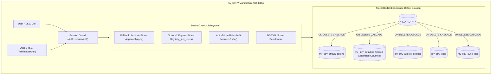

# my_STRV 🚴‍♂️🚣‍♂️🏃‍♂️

**my_STRV** ist eine private, mandantenfähige Hochleistungs-Analyseplattform für Strava-Daten, optimiert für Ausdauersportler in den Disziplinen **Radsport**, **Rudern** und **Laufen**.

Entwickelt für den Betrieb auf Standard-Webhosting-Umgebungen (z. B. Profihost mit PHP 8.2+ und MariaDB) mit modernem **„Clean Light Sports Tech“**-Frontend (TailwindCSS, Alpine.js, Apache ECharts, Leaflet.js).

---

## Inhaltsverzeichnis

- [Architektur & Kernprinzipien](#architektur--kernprinzipien)
- [Komponenten-Übersicht](#komponenten-übersicht)
- [Sportwissenschaftliche Berechnungen](#sportwissenschaftliche-berechnungen)
- [Systemanforderungen](#systemanforderungen)
- [Schritt-für-Schritt Deployment-Anleitung ("Deppensicher")](#schritt-für-schritt-deployment-anleitung-deppensicher)
- [Verzeichnisstruktur](#verzeichnisstruktur)
- [Versionshistorie & Release-Management](#versionshistorie--release-management)

---

## Architektur & Kernprinzipien



1. **Strikte Daten-Isolation (Multi-Tenant):** Jede Aktivität, jeder Token und jede Einstellung ist an eine `user_id` gekoppelt. Jeder Benutzer sieht ausschließlich seine eigenen Daten.
2. **DSGVO-Löschung ("Right to be Forgotten"):** Bei der Account-Löschung wird zuerst Stravas `POST /oauth/deauthorize` aufgerufen (Token-Entwertung) und anschließend der Benutzer gelöscht. MariaDBs `ON DELETE CASCADE` entfernt restlos alle Aktivitäten, Tokens, GPS-Tracks und Einstellungen.
3. **Schutz vor Web-Leaks:** Das Webserver-DocumentRoot zeigt zwingend auf `public_html/`. Konfiguration (`config/`), Logik (`src/`) und CLI-Tools (`bin/`) liegen geschützt außerhalb des öffentlichen Web-Roots.

---

## Komponenten-Übersicht

| Komponente | Datei | Beschreibung |
| :--- | :--- | :--- |
| **Konfiguration** | [`config/config.php`](file:///d:/Projekte/Web/my_STRV/config/config.php) | DB-Zugangsdaten, globale Strava-Defaults, Session-Cookie-Härtung (`SameSite=Strict`, `HttpOnly`, `Secure`). |
| **Datenbank-Schema** | [`schema.sql`](file:///d:/Projekte/Web/my_STRV/schema.sql) | DDL für MariaDB mit Präfix `my_strv_`, `ON DELETE CASCADE` und Stored Generated Columns (`elevation_per_km`, `pause_time`). |
| **Webserver Routing** | [`public_html/.htaccess`](file:///d:/Projekte/Web/my_STRV/public_html/.htaccess) | Apache Konfiguration mit `DirectoryIndex index.php`, automatischer HTTPS-Weiterleitung und Directory Browsing Schutz. |
| **Auth & Security** | [`src/Auth.php`](file:///d:/Projekte/Web/my_STRV/src/Auth.php) | Session-Guard (`requireAuth`), Session-Regenerierung gegen Fixation, Login, Logout und Kaskadenlöschung. |
| **OAuth2-Service** | [`src/StravaOAuth.php`](file:///d:/Projekte/Web/my_STRV/src/StravaOAuth.php) | Handshake mit Strava v3 API, automatischer Token-Refresh (5-Minuten-Vorlauf), Deautorisierung. |
| **API Client** | [`src/StravaClient.php`](file:///d:/Projekte/Web/my_STRV/src/StravaClient.php) | cURL-Wrapper mit Auswertung der Header `X-RateLimit-Limit` und `X-RateLimit-Usage` zur Vermeidung von HTTP 429 Sperren. |
| **Sync Engine** | [`src/SyncEngine.php`](file:///d:/Projekte/Web/my_STRV/src/SyncEngine.php) | Intelligenter Sync: Automatischer Wechsel zwischen paginiertem Initial-Load und Delta-Sync (`after={timestamp}`). Upsert in DB und Gear-Sync. |
| **Berechnungsservice** | [`src/MetricsCalculator.php`](file:///d:/Projekte/Web/my_STRV/src/MetricsCalculator.php) | Berechnet Metriken für Rudern, Radsport und Laufen. |
| **Ersteinrichtung (No-SSH)**| [`public_html/setup.php`](file:///d:/Projekte/Web/my_STRV/public_html/setup.php) | Sicheres Web-Setup für Erstbenutzer ohne SSH-Zugang (sperrt sich nach dem ersten User automatisch). |
| **CLI User Seeder** | [`bin/create_user.php`](file:///d:/Projekte/Web/my_STRV/bin/create_user.php) | Kommandozeilen-Skript zum Erstellen neuer Benutzer via SSH / Konsole. |
| **Diagnose-Tool** | [`public_html/test.php`](file:///d:/Projekte/Web/my_STRV/public_html/test.php) | Testet PHP-Version, Extensions, DB-Verbindung und Session-Zustand. |
| **REST APIs** | [`public_html/api/`](file:///d:/Projekte/Web/my_STRV/public_html/api) | JSON-Endpunkte: `stats_overview`, `fitness_trend`, `rowing_analysis`, `activities`, `yearly_comparison`, `settings`, `account_delete`. |
| **Frontend Cockpit** | [`public_html/index.php`](file:///d:/Projekte/Web/my_STRV/public_html/index.php) | Single-Page Dashboard in Alpine.js mit ECharts (Jahresvergleich, CTL/ATL/TSB, Ruder-Scatter) und Leaflet GPS-Heatmap. |

---

## Sportwissenschaftliche Berechnungen

### 1. Rudern (Indoor Ergometer & On-Water)
- **500m Split-Pace:** $500 / v_{\text{avg}}$ (formatiert in `mm:ss.s / 500m`).
- **DPS (Distance Per Stroke):** $\frac{\text{Distanz}}{\text{SPM} \times (\text{moving\_time} / 60)}$ (Meter pro Einzelzug).
- **JPS (Joules Per Stroke):** $\frac{P_{\text{avg}} \times 60}{\text{SPM}}$ (Verrichtete mechanische Energie pro Zug).

### 2. Radsport
- **W/kg:** $\frac{P_{\text{avg}}}{\text{Körpergewicht}}$.
- **Normalized Power (NP):** Bevorzugt Stravas `weighted_average_watts` (berücksichtigt physiologische Belastungsspitzen).
- **Intensity Factor (IF):** $IF = \frac{NP}{FTP}$.
- **Training Stress Score (TSS nach Coggan):** $TSS = \frac{t \times NP \times IF}{FTP \times 3600} \times 100$.
- **VAM:** $\frac{\text{elevation\_gain} \times 3600}{\text{moving\_time}}$ (Höhenmeter pro Stunde).
- **Efficiency Factor (EF):** $EF = \frac{NP}{\text{HF}_{\text{avg}}}$.

### 3. Fitness & Form Modell (Banister Impulse-Response)
- **CTL (Chronic Training Load - "Fitness"):** 42-Tage-Glättung ($k = 1 - e^{-1/42}$).
- **ATL (Acute Training Load - "Ermüdung"):** 7-Tage-Glättung ($k = 1 - e^{-1/7}$).
- **TSB (Training Stress Balance - "Form"):** $TSB = CTL - ATL$.

---

## Systemanforderungen

- **Betriebssystem:** Linux (z. B. Debian/Ubuntu auf Profihost) oder Windows (lokale Entwicklung).
- **PHP:** **PHP 8.2, 8.3, 8.4 oder 8.5** (zwingend erforderlich wegen Typ-Deklarationen und Sicherheitsfunktionen).
  - Benötigte Extensions: `pdo_mysql`, `curl`, `json`, `mbstring`, `session`.
- **Datenbank:** MariaDB ab 10.5 oder MySQL ab 8.0 (InnoDB Engine zwingend erforderlich für Foreign Keys).
- **Webserver:** Apache mit `mod_rewrite` & aktiviertem SSL-Zertifikat (HTTPS).
- **Strava Account:** Entwickler-Zugang unter [strava.com/settings/api](https://www.strava.com/settings/api).

---

## Schritt-für-Schritt Deployment-Anleitung ("Deppensicher")

### Schritt 1: Strava API-Anwendung registrieren
1. Logge dich bei [Strava](https://www.strava.com) ein und öffne [strava.com/settings/api](https://www.strava.com/settings/api).
2. Erstelle oder bearbeite die Anwendung:
   - **Application Name:** `my_STRV`
   - **Category:** `Datenimporteur` / `Training`
   - **Callback-Domain zur Autorisierung:** Deine Domain (z. B. `weltler.at`) – *Wichtig: Reine Domain ohne `https://`!*
3. Notiere dir die **Client-ID** und das **Client-Geheimnis (Client Secret)**.

---

### Schritt 2: Repository auf den Server laden
Entweder via Git oder FTP:

```bash
git clone https://github.com/BHW80/my_STRV.git
cd my_STRV
```

---

### Schritt 3: Subdomain & Webserver DocumentRoot konfigurieren (WICHTIG!)
1. Lege im Hosting-Panel eine Subdomain an (z. B. `strv.weltler.at`).
2. Stelle sicher, dass die **PHP-Version auf PHP 8.2 oder höher** eingestellt ist.
3. Aktiviere das kostenlose **Let's Encrypt SSL-Zertifikat** für die Subdomain.
4. Setze das Zielverzeichnis / DocumentRoot exakt auf den Unterordner **`public_html`**:
   ```text
   Zielverzeichnis: /.../my_STRV/public_html/
   ```

---

### Schritt 4: MariaDB-Datenbank & Schema anlegen
1. Erstelle im Hosting-Panel eine neue MariaDB-Datenbank und einen DB-Benutzer.
2. Importiere das Schema [`schema.sql`](file:///d:/Projekte/Web/my_STRV/schema.sql) über phpMyAdmin (Reiter *Importieren*) oder via SSH.

---

### Schritt 5: Konfiguration einrichten (`config/config.php`)
Kopiere `config.example.php` zu `config.php` und trage deine echten Daten ein:

```php
define('DB_HOST', 'localhost');
define('DB_NAME', 'deine_mariadb_datenbank');
define('DB_USER', 'dein_datenbank_benutzer');
define('DB_PASS', 'dein_geheimes_passwort');

define('GLOBAL_STRAVA_CLIENT_ID', '123456');
define('GLOBAL_STRAVA_CLIENT_SECRET', 'dein_strava_client_secret');
define('GLOBAL_STRAVA_REDIRECT_URI', 'https://strv.weltler.at/auth/callback.php');
```

---

### Schritt 6: Ersten Benutzer anlegen

* **Option A (Ohne SSH im Browser):**
  Öffne `https://strv.weltler.at/setup.php`, vergib Benutzername und Passwort. Das Skript richtet deinen Account ein und sperrt sich danach selbst.
* **Option B (Mit SSH / Terminal):**
  Führe `php bin/create_user.php` auf dem Server aus.

---

### Schritt 7: Starten & Strava verbinden!
1. Öffne im Browser: `https://strv.weltler.at/login.php`
2. Melde dich mit deinen Zugangsdaten an.
3. Klicke im Cockpit auf **„Mit Strava verbinden“**.
4. Nach der Freigabe startet ein Klick auf den **„Sync“**-Button deinen ersten Aktivitäten-Import!

---

## Verzeichnisstruktur

```text
my_STRV/
├── .agents/                  # Projekt-Richtlinien & AI-Agent-Regeln
├── bin/
│   └── create_user.php       # CLI-Tool zur Erstellung neuer Benutzer via Konsole
├── config/
│   ├── config.example.php    # Git-versionierte Konfigurationsvorlage
│   └── config.php            # Aktive Zugangsdaten (durch .gitignore geschützt)
├── public_html/              # ÖFFENTLICHES WEBSERVER-ROOT
│   ├── .htaccess             # Apache DirectoryIndex & HTTPS Redirect
│   ├── index.php             # Haupt-Cockpit (Alpine.js, ECharts, Leaflet)
│   ├── login.php             # Clean Light Login-Maske
│   ├── logout.php            # Session-Terminierung
│   ├── setup.php             # Web-Ersteinrichtung (No-SSH)
│   ├── test.php              # Diagnosetool
│   ├── auth/
│   │   ├── connect.php       # OAuth-Einstieg
│   │   └── callback.php      # OAuth-Callback & CSRF-Prüfung
│   └── api/
│       ├── sync.php          # Synchronisations-Trigger
│       ├── stats_overview.php# KPI-Summen & Trends
│       ├── fitness_trend.php # CTL / ATL / TSB Berechnung
│       ├── rowing_analysis.php# SPM vs DPS Scatter & Bestzeiten
│       ├── activities.php    # Paginierter Feed mit Polylines
│       ├── yearly_comparison.php# Kumulierter Jahresverlauf
│       ├── settings.php      # Athleten-FTP, Gewicht & Keys
│       └── account_delete.php# DSGVO Kaskadenlöschung
├── src/                      # Core Backend-Services
│   ├── Auth.php              # Session-Guard, Login, Logout & Löschlogik
│   ├── MetricsCalculator.php # Formeln für Rudern, Radsport, Laufen
│   ├── StravaClient.php      # cURL-Wrapper mit Rate-Limit Watcher
│   ├── StravaOAuth.php       # Token-Handshake & Auto-Refresh
│   └── SyncEngine.php        # Initial-Load & Delta-Sync Engine
├── .gitignore                # Schützt Passwörter und Systemdateien
├── POLICY.md                 # Verbindliche Entwicklungsrichtlinien
├── README.md                 # Vollständige Projektdokumentation
└── schema.sql                # MariaDB Tabellen mit ON DELETE CASCADE
```

---

## Versionshistorie & Release-Management

### [v0.2.0] - 2026-11-12 (Production Verified Release)
- **Subdomain Routing & Deployment:**
  - Hinzufügen von `public_html/.htaccess` für automatische HTTPS-Erzwingung und `DirectoryIndex`.
  - Anpassung der Standard-Redirect-URI auf `https://strv.weltler.at/auth/callback.php`.
- **Setup & Diagnostics:**
  - `public_html/setup.php`: Sicherer Web-Seeder zur Erstanlage von Benutzern ohne SSH-Zugang.
  - `public_html/test.php`: Diagnose-Skript für PHP-Version, DB-Verbindung und Server-Umgebung.
  - Dokumentation des PHP 8.2+ Mindeststandards für das Hosting.
- **Erfolgreiche Produktiv-Verifizierung:**
  - Login, Strava OAuth2-Handshake und Callback auf `strv.weltler.at` verifiziert und einsatzbereit.

### [v0.1.0] - 2026-11-12 (MVP Release)
- **Phasen 1–4:** Datenbank-Architektur, Multi-User Auth, Smart Sync Engine, geschützte REST-APIs und Frontend-Cockpit im Clean Light Sports Tech Design.
