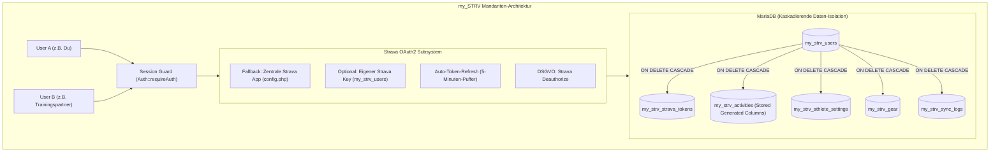

# my_STRV 🚴‍♂️🚣‍♂️🏃‍♂️

**my_STRV** ist eine private, mandantenfähige Hochleistungs-Analyseplattform für Strava-Daten, optimiert für Ausdauersportler in den Disziplinen **Radsport**, **Rudern** und **Laufen**.

Entwickelt für den Betrieb auf Standard-Webhosting-Umgebungen (z. B. Profihost mit PHP 8.5 und MariaDB) mit modernem **„Clean Light Sports Tech“**-Frontend (TailwindCSS, Alpine.js, Apache ECharts, Leaflet.js).

---

## Inhaltsverzeichnis

- [Architektur & Kernprinzipien](#architektur--kernprinzipien)
- [Komponenten-Übersicht](#komponenten-übersicht)
- [Sportwissenschaftliche Berechnungen](#sportwissenschaftliche-berechnungen)
- [Systemanforderungen](#systemanforderungen)
- [Schritt-für-Schritt Deployment-Anleitung ("Deppensicher")](#schritt-für-schritt-deployment-anleitung-deppensicher)
- [Verzeichnisstruktur](#verzeichnisstruktur)
- [Versionshistorie & Release-Management](#versionshistorie--release-management)

---

## Architektur & Kernprinzipien



1. **Strikte Daten-Isolation (Multi-Tenant):** Jede Aktivität, jeder Token und jede Einstellung ist an eine `user_id` gekoppelt. Jeder Benutzer sieht ausschließlich seine eigenen Daten.
2. **DSGVO-Löschung ("Right to be Forgotten"):** Bei der Account-Löschung wird zuerst Stravas `POST /oauth/deauthorize` aufgerufen (Token-Entwertung) und anschließend der Benutzer gelöscht. MariaDBs `ON DELETE CASCADE` entfernt restlos alle Aktivitäten, Tokens, GPS-Tracks und Einstellungen.
3. **Schutz vor Web-Leaks:** Das Webserver-DocumentRoot zeigt zwingend auf `public_html/`. Konfiguration (`config/`), Logik (`src/`) und CLI-Tools (`bin/`) liegen geschützt außerhalb des öffentlichen Web-Roots.

---

## Komponenten-Übersicht

| Komponente | Datei | Beschreibung |
| :--- | :--- | :--- |
| **Konfiguration** | [`config/config.php`](file:///d:/Projekte/Web/my_STRV/config/config.php) | DB-Zugangsdaten, globale Strava-Defaults, Session-Cookie-Härtung (`SameSite=Strict`, `HttpOnly`, `Secure`). |
| **Datenbank-Schema** | [`schema.sql`](file:///d:/Projekte/Web/my_STRV/schema.sql) | DDL für MariaDB mit Präfix `my_strv_`, `ON DELETE CASCADE` und Stored Generated Columns (`elevation_per_km`, `pause_time`). |
| **Auth & Security** | [`src/Auth.php`](file:///d:/Projekte/Web/my_STRV/src/Auth.php) | Session-Guard (`requireAuth`), Session-Regenerierung gegen Fixation, Login, Logout und Kaskadenlöschung. |
| **OAuth2-Service** | [`src/StravaOAuth.php`](file:///d:/Projekte/Web/my_STRV/src/StravaOAuth.php) | Handshake mit Strava v3 API, automatischer Token-Refresh (5-Minuten-Vorlauf), Deautorisierung. |
| **API Client** | [`src/StravaClient.php`](file:///d:/Projekte/Web/my_STRV/src/StravaClient.php) | cURL-Wrapper mit Auswertung der Header `X-RateLimit-Limit` und `X-RateLimit-Usage` zur Vermeidung von HTTP 429 Sperren. |
| **Sync Engine** | [`src/SyncEngine.php`](file:///d:/Projekte/Web/my_STRV/src/SyncEngine.php) | Intelligenter Sync: Automatischer Wechsel zwischen paginiertem Initial-Load und Delta-Sync (`after={timestamp}`). Upsert in DB und Gear-Sync. |
| **Berechnungsservice** | [`src/MetricsCalculator.php`](file:///d:/Projekte/Web/my_STRV/src/MetricsCalculator.php) | Berechnet Metriken für Rudern, Radsport und Laufen. |
| **CLI User Seeder** | [`bin/create_user.php`](file:///d:/Projekte/Web/my_STRV/bin/create_user.php) | Kommandozeilen-Skript zum Erstellen neuer Benutzer (Web-Zugriff geblockt). |
| **REST APIs** | [`public_html/api/`](file:///d:/Projekte/Web/my_STRV/public_html/api) | JSON-Endpunkte: `stats_overview`, `fitness_trend`, `rowing_analysis`, `activities`, `yearly_comparison`, `settings`, `account_delete`. |
| **Frontend Cockpit** | [`public_html/index.php`](file:///d:/Projekte/Web/my_STRV/public_html/index.php) | Single-Page Dashboard in Alpine.js mit ECharts (Jahresvergleich, CTL/ATL/TSB, Ruder-Scatter) und Leaflet GPS-Heatmap. |

---

## Sportwissenschaftliche Berechnungen

### 1. Rudern (Indoor Ergometer & On-Water)
- **500m Split-Pace:** $500 / v_{\text{avg}}$ (formatiert in `mm:ss.s / 500m`).
- **DPS (Distance Per Stroke):** $\frac{\text{Distanz}}{\text{SPM} \times (\text{moving\_time} / 60)}$ (Meter pro Einzelzug).
- **JPS (Joules Per Stroke):** $\frac{P_{\text{avg}} \times 60}{\text{SPM}}$ (Verrichtete mechanische Energie pro Zug).

### 2. Radsport
- **W/kg:** $\frac{P_{\text{avg}}}{\text{Körpergewicht}}$.
- **Normalized Power (NP):** Bevorzugt Stravas `weighted_average_watts` (berücksichtigt physiologische Belastungsspitzen).
- **Intensity Factor (IF):** $IF = \frac{NP}{FTP}$.
- **Training Stress Score (TSS nach Coggan):** $TSS = \frac{t \times NP \times IF}{FTP \times 3600} \times 100$.
- **VAM:** $\frac{\text{elevation\_gain} \times 3600}{\text{moving\_time}}$ (Höhenmeter pro Stunde).
- **Efficiency Factor (EF):** $EF = \frac{NP}{\text{HF}_{\text{avg}}}$.

### 3. Fitness & Form Modell (Banister Impulse-Response)
- **CTL (Chronic Training Load - "Fitness"):** 42-Tage-Glättung ($k = 1 - e^{-1/42}$).
- **ATL (Acute Training Load - "Ermüdung"):** 7-Tage-Glättung ($k = 1 - e^{-1/7}$).
- **TSB (Training Stress Balance - "Form"):** $TSB = CTL - ATL$.

---

## Systemanforderungen

- **Betriebssystem:** Linux (z. B. Debian/Ubuntu auf Profihost) oder Windows (lokale Entwicklung).
- **PHP:** 8.2 oder höher (empfohlen **PHP 8.5**).
  - Benötigte Extensions: `pdo_mysql`, `curl`, `json`, `mbstring`, `session`.
- **Datenbank:** MariaDB ab 10.5 oder MySQL ab 8.0 (InnoDB Engine zwingend erforderlich für Foreign Keys).
- **Webserver:** Apache mit `mod_rewrite` & aktiviertem SSL-Zertifikat (HTTPS).
- **Strava Account:** Entwickler-Zugang unter [strava.com/settings/api](https://www.strava.com/settings/api).

---

## Schritt-für-Schritt Deployment-Anleitung ("Deppensicher")

### Schritt 1: Strava API-Anwendung registrieren
1. Logge dich bei [Strava](https://www.strava.com) ein und öffne [strava.com/settings/api](https://www.strava.com/settings/api).
2. Erstelle eine neue Anwendung:
   - **Application Name:** `my_STRV`
   - **Category:** `Training`
   - **Club:** Leer lassen
   - **Authorization Callback Domain:** Deine Domain, z. B. `weltler.at`
3. Notiere dir die **Client ID** und das **Client Secret**.

---

### Schritt 2: Repository auf den Server klonen
Verbinde dich via SSH mit deinem Server (z. B. Profihost) und wechsle in das gewünschte Verzeichnis:

```bash
git clone https://github.com/BHW80/my_STRV.git
cd my_STRV
```

---

### Schritt 3: Webserver DocumentRoot konfigurieren (WICHTIG!)
Stelle im Hosting-Control-Panel (z. B. cPanel, Plesk oder Profihost Kundencenter) sicher, dass die Domain oder Subdomain auf den Unterordner **`public_html/`** verweist:

```text
Pfad auf dem Server: /var/www/vhosts/weltler.at/my_STRV/public_html
```

*Sicherheitsgrund:* Dadurch sind deine Datenbank-Passwörter in `config/` und die Core-Klassen in `src/` für Besucher niemals direkt per HTTP abrufbar.

---

### Schritt 4: MariaDB-Datenbank & Schema anlegen
1. Erstelle im Hosting-Panel eine neue MariaDB-Datenbank (z. B. `my_strv_db`) und einen Datenbank-Benutzer mit Rechten auf diese DB.
2. Importiere das Schema [`schema.sql`](file:///d:/Projekte/Web/my_STRV/schema.sql):
   - **Via SSH / Terminal:**
     ```bash
     mysql -u DEIN_DB_USER -p DEIN_DB_NAME < schema.sql
     ```
   - **Oder via phpMyAdmin:**
     Öffne phpMyAdmin, wähle die Datenbank aus, gehe auf den Reiter *Importieren* und lade `schema.sql` hoch.

---

### Schritt 5: Konfiguration einrichten (`config/config.php`)
Kopiere die Vorlage und trage deine echten Zugangsdaten ein:

```bash
cp config/config.example.php config/config.php
nano config/config.php
```

Passe folgende Werte an:
```php
define('DB_HOST', 'localhost');
define('DB_NAME', 'my_strv_db');
define('DB_USER', 'my_strv_user');
define('DB_PASS', 'DeinSicheresPasswort');

define('GLOBAL_STRAVA_CLIENT_ID', '123456');
define('GLOBAL_STRAVA_CLIENT_SECRET', 'abcdef0123456789...');
define('GLOBAL_STRAVA_REDIRECT_URI', 'https://weltler.at/auth/callback.php');
```

---

### Schritt 6: Ersten Benutzer erstellen (CLI Seeder)
Da die Plattform privat ist und keine offene Registrierung besitzt, erstelle deinen Benutzer direkt über die Kommandozeile:

```bash
php bin/create_user.php
```
Das Skript fragt interaktiv nach:
1. **Benutzername:** (z. B. `bernd`)
2. **Passwort:** (min. 8 Zeichen)

---

### Schritt 7: Starten & Strava verbinden!
1. Öffne im Browser: `https://weltler.at/login.php`
2. Melde dich mit deinem erstellten Benutzer an.
3. Klicke im Dashboard auf **„Mit Strava verbinden“**.
4. Bestätige bei Strava die Berechtigungen für Aktivitäten und Profil.
5. Nach der Rückleitung startet ein Klick auf den **„Sync“**-Button den ersten Initial-Import!

---

## Verzeichnisstruktur

```text
my_STRV/
├── .agents/                  # Projekt-Richtlinien & AI-Agent-Regeln
├── bin/
│   └── create_user.php       # CLI-Tool zur Erstellung neuer Benutzer (Web-Zugriff geblockt)
├── config/
│   ├── config.example.php    # Git-versionierte Konfigurationsvorlage
│   └── config.php            # Aktive Zugangsdaten (durch .gitignore geschützt)
├── public_html/              # ÖFFENTLICHES WEBSERVER-ROOT
│   ├── index.php             # Haupt-Cockpit (Alpine.js, ECharts, Leaflet)
│   ├── login.php             # Clean Light Login-Maske
│   ├── logout.php            # Session-Terminierung
│   ├── auth/
│   │   ├── connect.php       # OAuth-Einstieg
│   │   └── callback.php      # OAuth-Callback & CSRF-Prüfung
│   └── api/
│       ├── sync.php          # Synchronisations-Trigger
│       ├── stats_overview.php# KPI-Summen & Trends
│       ├── fitness_trend.php # CTL / ATL / TSB Berechnung
│       ├── rowing_analysis.php# SPM vs DPS Scatter & Bestzeiten
│       ├── activities.php    # Paginierter Feed mit Polylines
│       ├── yearly_comparison.php# Kumulierter Jahresverlauf
│       ├── settings.php      # Athleten-FTP, Gewicht & Keys
│       └── account_delete.php# DSGVO Kaskadenlöschung
├── src/                      # Core Backend-Services
│   ├── Auth.php              # Session-Guard, Login, Logout & Löschlogik
│   ├── MetricsCalculator.php # Formeln für Rudern, Radsport, Laufen
│   ├── StravaClient.php      # cURL-Wrapper mit Rate-Limit Watcher
│   ├── StravaOAuth.php       # Token-Handshake & Auto-Refresh
│   └── SyncEngine.php        # Initial-Load & Delta-Sync Engine
├── .gitignore                # Schützt Passwörter und Systemdateien
├── POLICY.md                 # Verbindliche Entwicklungsrichtlinien
├── README.md                 # Diese Dokumentation
└── schema.sql                # MariaDB Tabellen mit ON DELETE CASCADE
```

---

## Versionshistorie & Release-Management

Dieses Projekt folgt dem [Semantic Versioning](https://semver.org/lang/de/)-Standard (`MAJOR.MINOR.PATCH`).

### [v0.1.0] - 2026-11-12 (MVP Release)
- **Phase 1:** MariaDB Schema mit `my_strv_`-Präfix, Foreign Keys (`ON DELETE CASCADE`), Session-Guard, Strava OAuth2 mit Auto-Refresh und CLI User Seeder.
- **Phase 2:** Smart Sync Engine mit Rate-Limit-Watcher (15-Min & Tageslimit), Initial-Load und Delta-Sync sowie sportwissenschaftlicher `MetricsCalculator` (Ruder-DPS/Pace, Rad-NP/TSS/IF/VAM, Lauf-Pace).
- **Phase 3:** Geschützte REST-APIs für Übersicht, Fitness & Form (CTL/ATL/TSB), Ruder-Spezialanalyse, Aktivitäten-Feed mit Paginierung, kumulativen Jahresvergleich und permanente DSGVO-Accountlöschung.
- **Phase 4:** Vollständiges **Clean Light Sports Tech** Cockpit auf Basis von TailwindCSS, Alpine.js, Apache ECharts und Leaflet.js (CartoDB Positron Kacheln).
