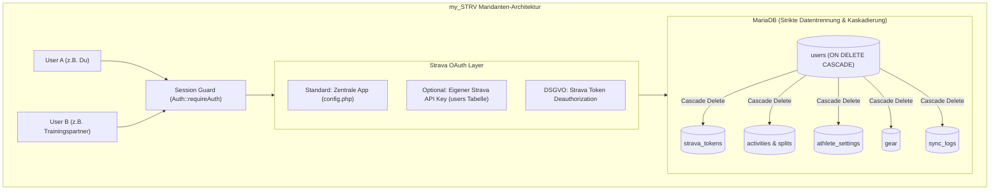

# Master-Systemprompts: my_STRV (weltler.at)

Dieses Dokument enthält die gebrauchsfertigen Systemprompts für den vollständigen Aufbau deiner persönlichen, mandantenfähigen Strava-Analyseplattform **my_STRV**. 

Das System ist in **4 aufeinander aufbauende Phasen** gegliedert, um Code-Platzhalter (`TODOs`) zu verhindern und jede Komponente produktionsreif auszuprogrammieren.

---

## Architektur-Leitplanken von my_STRV



* **Strikte Daten-Isolation:** Jede Aktivität, jeder Token und jede Einstellung ist fest an eine `user_id` gekoppelt. Niemand kann fremde Daten abrufen.
* **DSGVO-konforme Datenlöschung ("Right to be Forgotten"):** 
  1. Offizielle Strava-Deautorisierung (`POST /oauth/deauthorize`), um der App den Zugriff bei Strava zu entziehen.
  2. Atomare Löschung aller Aktivitäts-, Geo-, Einstellungs- und Token-Datensätze in MariaDB via `ON DELETE CASCADE`.
* **Flexible Strava-Anbindung:** Standardmäßig zentrale App; optional eigener Strava API Key pro User.
* **Sicherheit:** Passwort-Hashing via `PASSWORD_DEFAULT` (Argon2id/Bcrypt), `SameSite=Strict` Sessions, geschützte REST-APIs mit HTTP 401.

---

## Phasen-Übersicht

1. **Phase 1: DB-Architektur, Multi-User-Auth & my_STRV OAuth2-Subsystem** 
   * Tabellen mit `user_id`-Scoping und `ON DELETE CASCADE`, User-Login, Token-Verwaltung, Deautorisierungs-Logik.
2. **Phase 2: Smart Sync Engine & Berechnungsservice** 
   * Paginierter Initial Load, Delta-Sync, Rate-Limiting, Ruder- (DPS, 500m) & Rad-Metriken (TSS, NP, IF, VAM).
3. **Phase 3: Geschützte Backend REST-API, Aggregationen & Account-Löschung** 
   * Session-gesicherte JSON-Endpunkte (gefiltert auf `user_id`), Fitness/TSB-Modell, Jahresvergleiche, Lösch-Endpunkt mit Passwort-Bestätigung.
4. **Phase 4: Frontend Cockpit, Login Screen & Gefahrenzone** 
   * Responsive UI ("Dark Sports Tech"), Login-Maske, Einstellungs-Modal (FTP, Gewicht, eigene API-Keys, Account permanent löschen), Apache ECharts & Leaflet GPS-Heatmap.

---

## Phase 1: DB-Architektur, Multi-User-Auth & OAuth2-Subsystem

Verwende diesen Prompt, um das Fundament für **my_STRV** zu erstellen.

````markdown
### ROLLE & KONTEXT
Du bist ein Senior PHP- & Datenbank-Sicherheitsexperte. Wir entwickeln die mandantenfähige Strava-Analyseplattform "my_STRV" für die Domain `weltler.at`.
Hosting-Umgebung: Profihost (PHP 8.5, MariaDB, Apache, cURL, PDO, HTTPS).
WICHTIG: Die Website darf NICHT öffentlich einsehbar sein. Jeder registrierte Benutzer sieht nach dem Login AUSSCHLIESSLICH seine eigenen Daten. Zudem muss ein Benutzer seinen Account und alle gespeicherten Daten jederzeit rückstandslos löschen können.

### ZIEL VON PHASE 1
Erstelle das vollständige MariaDB-Schema mit Mandantentrennung (`user_id`) und Kaskadierung (`ON DELETE CASCADE`), ein sicheres User-Authentifizierungs-Subsystem (Login/Logout/Session-Guard) sowie den OAuth2-Flow für Strava API v3 inklusive Deautorisierungs-Funktion.
Es dürfen KEINE Code-Lücken, Pseudocodes oder "// TODO: implement later"-Kommentare enthalten sein.

### ANFORDERUNGEN & SPEZIFIKATION

1. **Konfiguration (`config/config.php`)**:
   - DB-Credentials (Host, Name, User, Pass).
   - Globale Strava-Credentials als Fallback (`GLOBAL_STRAVA_CLIENT_ID`, `GLOBAL_STRAVA_CLIENT_SECRET`, `GLOBAL_STRAVA_REDIRECT_URI`).
   - Sichere Session-Initialisierung:
     - `session_set_cookie_params(['lifetime' => 86400 * 30, 'httponly' => true, 'secure' => true, 'samesite' => 'Strict'])`
   - PDO-Instanz mit `PDO::ERRMODE_EXCEPTION` und `PDO::FETCH_ASSOC`.

2. **MariaDB Schema (`schema.sql`)**:
   - `users`:
     - `id INT AUTO_INCREMENT PRIMARY KEY`
     - `username VARCHAR(50) UNIQUE NOT NULL`
     - `password_hash VARCHAR(255) NOT NULL`
     - `custom_client_id VARCHAR(50) NULL`
     - `custom_client_secret VARCHAR(100) NULL`
     - `created_at TIMESTAMP DEFAULT CURRENT_TIMESTAMP`
     - `last_login DATETIME NULL`
   - `strava_tokens`: 
     - `user_id INT PRIMARY KEY`
     - `FOREIGN KEY (user_id) REFERENCES users(id) ON DELETE CASCADE`
     - `athlete_id BIGINT NOT NULL`
     - `access_token VARCHAR(255) NOT NULL`
     - `refresh_token VARCHAR(255) NOT NULL`
     - `expires_at INT NOT NULL`
     - `scope VARCHAR(100)`
     - `updated_at TIMESTAMP DEFAULT CURRENT_TIMESTAMP ON UPDATE CURRENT_TIMESTAMP`
   - `athlete_settings`: 
     - `user_id INT PRIMARY KEY`
     - `FOREIGN KEY (user_id) REFERENCES users(id) ON DELETE CASCADE`
     - `ftp INT DEFAULT 250`
     - `weight FLOAT DEFAULT 75.0`
     - `max_hr INT DEFAULT 190`
     - `rest_hr INT DEFAULT 50`
   - `activities`: Speichert Aktivitäten strikt isoliert:
     - `id BIGINT NOT NULL`
     - `user_id INT NOT NULL`
     - `athlete_id BIGINT NOT NULL`
     - PRIMARY KEY `(id, user_id)`
     - `FOREIGN KEY (user_id) REFERENCES users(id) ON DELETE CASCADE`
     - Standardfelder: `name`, `sport_type`, `start_date` (DATETIME), `distance` (FLOAT), `moving_time` (INT), `elapsed_time` (INT), `total_elevation_gain` (FLOAT).
     - Leistungsfelder: `average_speed`, `max_speed`, `average_cadence`, `average_heartrate`, `max_heartrate`, `average_watts`, `max_watts`, `weighted_average_watts`, `kilojoules`, `suffer_score`.
     - Ruder-Spezifische Felder: `split_500m_seconds` (FLOAT), `distance_per_stroke` (FLOAT), `joules_per_stroke` (FLOAT), `max_cadence` (FLOAT).
     - Rad-Spezifische Felder: `w_kg` (FLOAT), `normalized_power` (FLOAT), `intensity_factor` (FLOAT), `tss` (FLOAT), `efficiency_factor` (FLOAT), `vam` (FLOAT).
     - Map: `summary_polyline` (TEXT), `start_lat` (DOUBLE), `start_lng` (DOUBLE).
     - Generated Columns:
       - `elevation_per_km` (STORED: `ROUND(total_elevation_gain / (distance / 1000), 2)`).
       - `pause_time` (STORED: `elapsed_time - moving_time`).
     - JSON-Dump: `raw_summary JSON`.
     - Indizes: `idx_user_date (user_id, start_date)`, `idx_user_sport (user_id, sport_type)`.
   - `gear`: 
     - `id VARCHAR(50)`, `user_id INT NOT NULL`, `name`, `brand_name`, `model_name`, `distance` (FLOAT), `primary_gear` (BOOLEAN), PRIMARY KEY `(id, user_id)`.
     - `FOREIGN KEY (user_id) REFERENCES users(id) ON DELETE CASCADE`
   - `sync_logs`: 
     - `id INT AI PK`, `user_id INT NOT NULL`, `sync_type`, `status`, `items_synced`, `rate_limit_15min_remaining`, `message`, `created_at`.
     - `FOREIGN KEY (user_id) REFERENCES users(id) ON DELETE CASCADE`

3. **Authentifizierungs- & Account-Service (`src/Auth.php`)**:
   - `login(string $username, string $password): bool`: Authentifiziert, erneuert Session, setzt `$_SESSION['user_id']`.
   - `logout(): void`: Zerstört Session und löscht Cookies.
   - `id(): ?int`: Gibt die aktuelle `user_id` zurück.
   - `requireAuth(): int`: Gibt `user_id` zurück oder bricht ab (Web $\rightarrow$ Redirect, API $\rightarrow$ HTTP 401).
   - `deleteAccount(int $userId, string $passwordConfirm): bool`:
     - Verifiziert das Passwort des Nutzers erneut zur Sicherheit.
     - Ruft `StravaOAuth::deauthorize($userId)` auf, um den Token bei Strava ungültig zu machen.
     - Führt `DELETE FROM users WHERE id = :userId` aus (MariaDB löscht dank `ON DELETE CASCADE` restlos alle Aktivitäten, Tokens, Einstellungen und Logs!).
     - Führt `logout()` aus.

4. **CLI User Seeder (`bin/create_user.php`)**:
   - Standalone CLI-Skript zum Erstellen des ersten Benutzers.

5. **Multi-Tenant OAuth Service (`src/StravaOAuth.php`)**:
   - `getAuthorizationUrl(int $userId): string`
   - `handleCallback(int $userId, string $code): array`: Speichert Tokens verknüpft mit `user_id`.
   - `getValidAccessToken(int $userId): string`: Prüft Ablaufzeit und führt Auto-Refresh durch.
   - `deauthorize(int $userId): void`: Sendet `POST https://www.strava.com/oauth/deauthorize?access_token={token}`, damit Strava den Zugriff widerruft.

6. **Web-Einstiegspunkte**:
   - `public_html/login.php`: Dark-Mode Login-Maske für "my_STRV".
   - `public_html/logout.php`: Session-Terminierung.
   - `public_html/auth/connect.php`: Startet OAuth für den eingeloggten Nutzer.
   - `public_html/auth/callback.php`: Verarbeitet Callback für den eingeloggten Nutzer.
````

---

## Phase 2: Smart Sync Engine & Berechnungsservice

Verwende diesen Prompt, sobald Phase 1 steht, um die Synchronisation und die Metriken-Berechnung zu implementieren.

````markdown
### ROLLE & KONTEXT
Du bist ein Senior Backend-Entwickler für Hochleistungs-APIs. 
Wir bauen Phase 2 von "my_STRV". Phase 1 (DB mit Kaskadierung, Multi-User Auth-Guard und OAuth) ist fertiggestellt.

### ZIEL VON PHASE 2
Schreibe die vollständige Sync-Engine in PHP 8.5. 
Sie muss Strava Rate Limits respektieren, sowohl den **Initial Load** (Paginierung) als auch den **Delta Sync** für den jeweils eingeloggten Nutzer ausführen und alle abgeleiteten Werte (z.B. Rudern DPS, 500m-Pace, Rad-TSS/NP, VAM) exakt berechnen.

### ANFORDERUNGEN & SPEZIFIKATION

1. **Metriken-Berechnungs-Service (`src/MetricsCalculator.php`)**:
   - `calculateRowingMetrics(array $act): array`:
     - `split_500m_seconds = (average_speed > 0) ? (500 / average_speed) : null`
     - `distance_per_stroke = (cadence > 0 && moving_time > 0) ? (distance / (cadence * (moving_time / 60))) : null`
     - `joules_per_stroke = (cadence > 0 && avg_watts > 0) ? (avg_watts * 60 / cadence) : null`
   - `calculateCyclingMetrics(array $act, float $ftp, float $weight): array`:
     - `w_kg = ($weight > 0 && avg_watts > 0) ? round(avg_watts / $weight, 2) : null`
     - `normalized_power = act['weighted_average_watts'] ?? act['average_watts']`
     - `intensity_factor = ($ftp > 0 && NP > 0) ? round(NP / $ftp, 3) : null`
     - `tss = ($ftp > 0 && NP > 0 && moving_time > 0) ? round((moving_time * NP * IF) / ($ftp * 3600) * 100, 1) : null`
     - `vam = (moving_time > 0 && elevation_gain > 0) ? round((elevation_gain * 3600) / moving_time, 1) : null`
     - `efficiency_factor = (NP > 0 && avg_hr > 0) ? round(NP / avg_hr, 2) : null`
   - `calculateRunningMetrics(array $act): array`:
     - `pace_min_km = (average_speed > 0) ? (1000 / average_speed) : null`
     - `stride_length = (cadence > 0 && average_speed > 0) ? round((average_speed * 60) / (cadence * 2), 2) : null`

2. **Strava API Client mit Rate Limit Watcher (`src/StravaClient.php`)**:
   - cURL-Wrapper für `https://www.strava.com/api/v3/`.
   - Liest Header `X-RateLimit-Limit` und `X-RateLimit-Usage` aus und bricht bei Überschreitung kontrolliert ab.

3. **Sync Engine (`src/SyncEngine.php`)**:
   - Methode `sync(int $userId, bool $forceFull = false): array`:
     - Liest Einstellungen (`ftp`, `weight`) aus `athlete_settings WHERE user_id = ?`.
     - Holt letzten Aktivitäts-Timestamp: `SELECT UNIX_TIMESTAMP(MAX(start_date)) FROM activities WHERE user_id = ?`.
     - Modus Initial Load (wenn leer oder `$forceFull`):
       - Schleife über `GET /athlete/activities?page=X&per_page=200` bis Liste leer.
     - Modus Delta Sync (wenn Timestamp vorhanden):
       - Aufruf von `GET /athlete/activities?after={last_timestamp}&per_page=200`.
     - Speichern mit `user_id`:
       - Berechnung der Metriken via `MetricsCalculator`.
       - `INSERT ... ON DUPLICATE KEY UPDATE` mit `(id, user_id)`.
       - Speichert `summary_polyline` für Karten.
     - Aktualisiert `gear` für diesen `user_id`.
     - Schreibt Eintrag in `sync_logs` mit `user_id`.
     - Rückgabe: `['status' => 'success', 'added' => X, 'updated' => Y, 'mode' => 'delta'|'full']`.

4. **Web-Trigger (`public_html/api/sync.php`)**:
   - Prüft `$userId = Auth::requireAuth()`.
   - Startet `SyncEngine::sync($userId)` und liefert JSON zurück.
````

---

## Phase 3: Geschützte Backend REST-API, Aggregationen & Account-Löschung

Verwende diesen Prompt für die Daten-Bereitstellung und die Lösch-APIs.

````markdown
### ROLLE & KONTEXT
Du bist ein Backend- & Performance-Spezialist für SQL und RESTful APIs.
Wir bauen Phase 3 für "my_STRV" auf `weltler.at`. Phasen 1 und 2 sind vollständig implementiert.

### ZIEL VON PHASE 3
Erstelle performante REST-API-Endpunkte in PHP 8.5. 
JEDE Datenbankabfrage MUSS strikt auf die `user_id` der aktuellen Session gefiltert sein.
Zusätzlich erstellen wir die API zur permanenten Account- und Datenlöschung.

### ENDPUNKTE & SPEZIFIKATION

1. **Dashboard Overview (`public_html/api/stats_overview.php`)**:
   - Filtert strikt `WHERE user_id = :user_id`.
   - Parameter: `year` (optional).
   - Liefert All-Time & YTD Metriken, Sportartenaufteilung, 28-Tage-Trend.

2. **Fitness & Form Modell: CTL / ATL / TSB (`public_html/api/fitness_trend.php`)**:
   - Filtert strikt `WHERE user_id = :user_id`.
   - Berechnet tägliche Belastungen und exponentiell geglättete Durchschnitte ($CTL_{42}$, $ATL_7$, $TSB$).

3. **Rudern Spezial-Endpunkt (`public_html/api/rowing_analysis.php`)**:
   - Filtert `WHERE user_id = :user_id AND sport_type = 'Rowing'`.
   - Historie 500m-Pace, Schlagzahl vs. Meter pro Schlag (DPS), Bestzeiten.

4. **Aktivitäten-Feed & Filter (`public_html/api/activities.php`)**:
   - Filtert `WHERE user_id = :user_id`.
   - Paginierte Aktivitätskarten inkl. `summary_polyline`.

5. **Jahresvergleich kumulativ (`public_html/api/yearly_comparison.php`)**:
   - Filtert `WHERE user_id = :user_id`.
   - Tag-des-Jahres-Verlauf für Multi-Line-Vergleiche.

6. **User Settings API (`public_html/api/settings.php`)**:
   - `GET`: Aktuelle Trainings- und Strava-Key-Werte des Users.
   - `POST`: Speichern von FTP, Gewicht, max. HF und optionalen Custom Strava Keys.

7. **Permanente Account-Löschung (`public_html/api/account_delete.php`)**:
   - **Methode: POST**
   - Prüft `$userId = Auth::requireAuth()`.
   - Liest JSON Payload `{ "password_confirm": "..." }`.
   - Ruft `Auth::deleteAccount($userId, $passwordConfirm)` auf.
   - Bei Erfolg: Gibt JSON `{"success": true, "message": "Account und alle Daten wurden permanent gelöscht."}` zurück.
   - Bei falschem Passwort: HTTP 400 Bad Request mit Fehlermeldung.
````

---

## Phase 4: Frontend-Cockpit, Login Screen & Gefahrenzone

Verwende diesen Prompt für die visuelle Aufbereitung von **my_STRV**.

````markdown
### ROLLE & KONTEXT
Du bist ein erfahrener Frontend-Engineer und Data-Visualization-Spezialist.
Wir bauen Phase 4 von "my_STRV" für `weltler.at`. Alle Backend-APIs (Phasen 1–3) sind vollständig funktionsfähig und gesichert.

### ZIEL VON PHASE 4
Erstelle ein modernes, responsives Dashboard ("Dark Sports Tech"-Look, Brand: "my_STRV") inklusive Einstellungs-Modal mit Gefahrenzone für die permanente Datenlöschung.
Tech-Stack: HTML5/PHP, TailwindCSS (via CDN), Alpine.js, Apache ECharts, Leaflet.js.

### KOMPONENTEN & SPEZIFIKATION

1. **Login Screen (`public_html/login.php`)**:
   - Zentrierte Dark-Mode-Card mit Logo "my_STRV".
   - Benutzername & Passwort, Fehlermeldung bei falschem Login.
   - Nach Login: Weiterleitung auf `index.php`.

2. **Dashboard Entry (`public_html/index.php`)**:
   - Startet mit `Auth::requireAuth()`.
   - Zeigt das Haupt-Dashboard des eingeloggten Nutzers.

3. **Header & Steuerungsleiste**:
   - Brand-Logo **my_STRV** & Benutzername.
   - Letzter Sync-Zeitstempel.
   - **"Jetzt synchronisieren"-Button** mit Live-Animation.
   - Jahresauswahl (Dropdown: All-Time, 2026, 2025 etc.).
   - **Settings-Modal-Button**: Öffnet Modal für Einstellungen & Gefahrenzone.
   - **Logout-Button**: Beendet Session.

4. **Settings-Modal mit Gefahrenzone**:
   - **Tab 1: Athleten-Profil**: Körpergewicht (kg), Schwellenleistung (FTP in Watt), Max. Herzfrequenz.
   - **Tab 2: Strava API Verbindung**: Anzeige des aktuellen Verbindungsstatus ("Verbunden als [Name]") und Option zur Eingabe eigener Strava API Keys.
   - **Tab 3: Gefahrenzone (Account löschen)**:
     - Roter Warnbereich: *"Achtung: Dies löscht deinen Account, alle importierten Strava-Aktivitäten, GPS-Tracks und persönlichen Berechnungen unwiderruflich aus unserer Datenbank und trennt die Verbindung zu Strava."*
     - Bestätigungsabfrage mit Passwort-Eingabe.
     - "Account endgültig löschen"-Button mit Lade-Status.
     - Nach erfolgreicher Löschung: Weiterleitung zur Login-Seite mit Erfolgsmeldung.

5. **KPI-Karten & Visualisierungs-Kacheln**:
   - KPI-Karten (Distanz YTD, Höhenmeter YTD, Trainingszeit, TSB Form-Score).
   - ECharts Kumulativer Jahresvergleich (2026 vs. 2025 vs. 2024).
   - ECharts Fitness & Form (CTL / ATL / TSB).
   - Ruder-Hub (500m-Schnitt, Schlagzahl, DPS).
   - Rad-Hub (Watt/kg, Powerverläufe).
   - Leaflet Gesamt-GPS-Heatmap aus allen `summary_polyline`-Daten.
````

---

## Finale Ordnerstruktur von my_STRV

```text
my_STRV/
├── bin/
│   └── create_user.php       (CLI-Skript zur Erstellung von Benutzern)
├── config/
│   └── config.php            (DB-Credentials & globale Strava-Defaults außerhalb von public_html)
├── src/
│   ├── Auth.php              (Session Guard, Login, Logout & vollständige Account-Löschung)
│   ├── StravaOAuth.php       (OAuth Handshake, Auto-Refresh & Strava Deauthorize)
│   ├── StravaClient.php      (cURL Client mit Rate Limit Watcher)
│   ├── SyncEngine.php        (Paginierter Initial Load & Delta Sync pro user_id)
│   └── MetricsCalculator.php (Berechnung für Rudern DPS/500m, Rad-TSS/NP/IF etc.)
├── public_html/
│   ├── index.php             (Geschütztes Dashboard)
│   ├── login.php             (my_STRV Login Screen)
│   ├── logout.php            (Session Beendigung & Redirect)
│   ├── auth/
│   │   ├── connect.php       (OAuth Einstieg zu Strava pro User)
│   │   └── callback.php      (OAuth Callback von Strava pro User)
│   ├── api/
│   │   ├── sync.php          (Sync Trigger)
│   │   ├── stats_overview.php
│   │   ├── fitness_trend.php
│   │   ├── rowing_analysis.php
│   │   ├── activities.php
│   │   ├── settings.php      (User FTP, Gewicht & Custom Keys)
│   │   └── account_delete.php (Permanente Account- & Datenlöschung)
│   └── assets/
│       ├── css/
│       └── js/
└── schema.sql                (Mandantenfähiges DB-Schema mit ON DELETE CASCADE)
```
